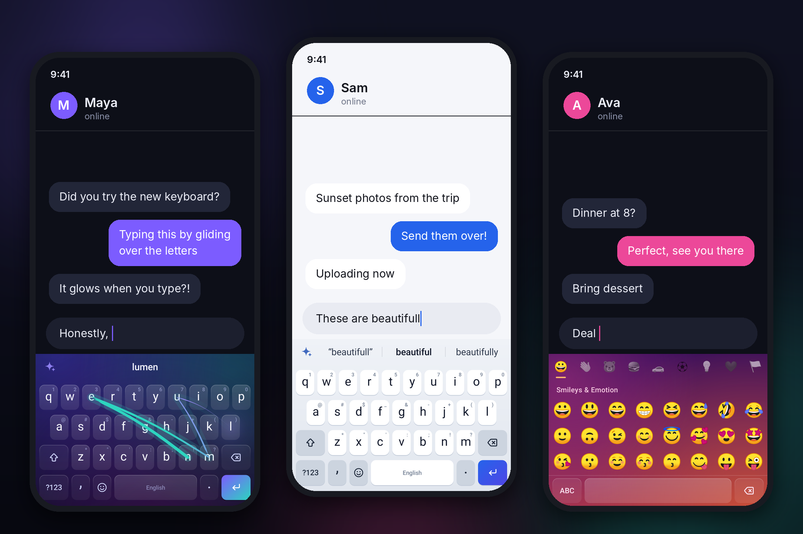
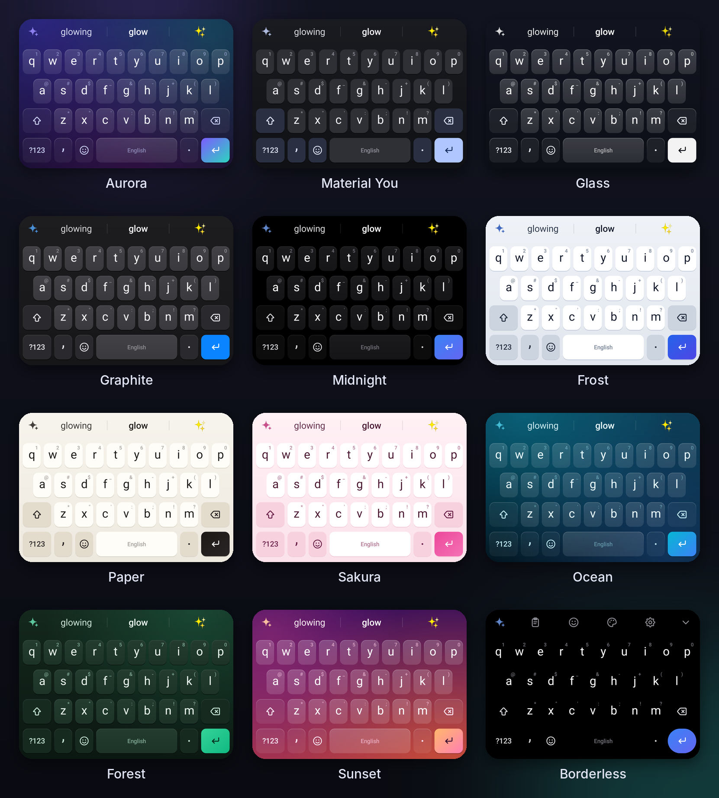
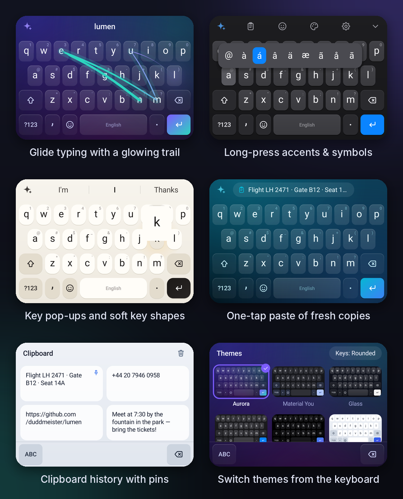
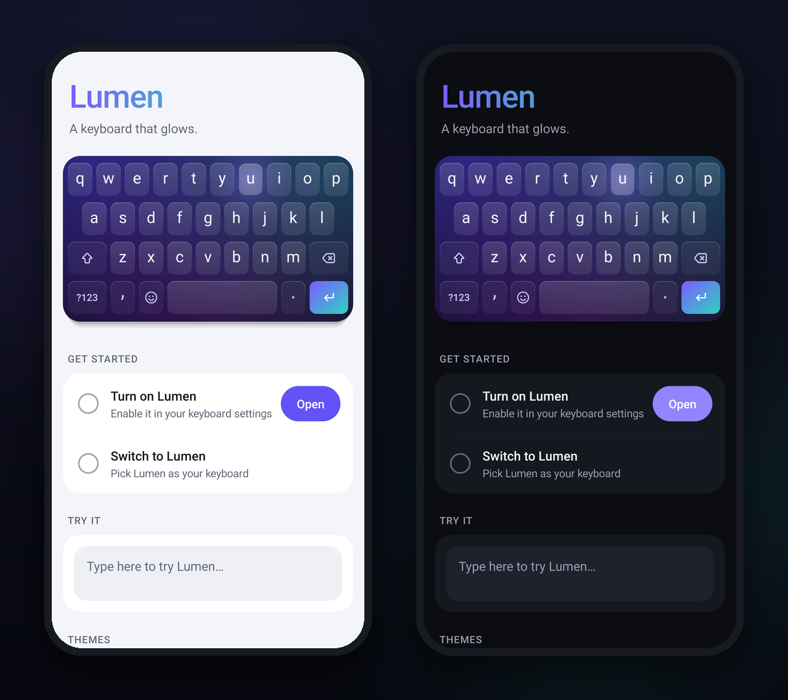

# Lumen

**A keyboard for Android that glows.**



Lumen is a fast, private, beautifully drawn keyboard. Every key, icon and effect
is painted in code: keys squash and spring back under your fingers, a soft bloom
of light spreads from each press, glide typing leaves a glowing comet trail, and
eleven hand-tuned themes (including Material You and a real frosted-glass theme)
make it feel at home on any phone.

## Highlights

- **Light you can feel.** Spring-loaded keys, light blooms, floating key pop-ups,
  a gradient enter key and crisp icons drawn on a single 24-unit grid.
- **Glide typing.** Slide across the letters and Lumen matches the shape and
  position of your path against 60,000 words, with a live preview as you glide.
- **Autocorrect that knows the keyboard.** It weighs which keys are neighbours and
  exactly where you tapped, fixes missing apostrophes (`dont` → `don't`), and one
  tap of backspace undoes it.
- **Predictions.** Word completions, next-word predictions, emoji suggestions
  (🍕 when you type “pizza”), smart punctuation spacing, double-space full stop and
  auto-capitalisation.
- **Learns you, privately.** New words and phrases are learned on the device.
  Lumen has no internet permission, and it never learns from password or
  incognito fields.
- **Eleven themes.** Aurora, Material You, Glass (real background blur on
  Android 12+), Graphite, Midnight (AMOLED), Frost, Paper, Sakura, Ocean, Forest
  and Sunset. Four key shapes plus a borderless mode, all switchable from the keyboard.
- **Everything at hand.** Emoji with skin tones and recents, clipboard history
  with pins and a one-tap paste chip, space-bar cursor control, swipe left from
  backspace to delete whole words, long-press for accents and symbols, an optional
  number row, and QWERTY, QWERTZ, AZERTY, Colemak and Dvorak layouts.
- **Built to be light.** No third-party libraries; the keyboard is a handful of
  custom views drawn on the canvas.

## Screenshots







## Install

1. Get an APK: open this repository's **Actions** tab, pick the latest **Build**
   run and download the `lumen-apk` artifact. Or build it yourself (below).
2. Install it and open **Lumen**.
3. Follow the two setup steps: turn Lumen on, then switch to it.

The release APK is signed with a debug key so it installs directly. Use your
own signing key before publishing it anywhere.

## Build

You need JDK 17+ and the Android SDK (Android Studio is the easiest way).

```sh
./gradlew assembleRelease        # app/build/outputs/apk/release/app-release.apk
./gradlew testDebugUnitTest      # typing engine tests and the glide benchmark
```

## How it works

| Package | What lives there |
| --- | --- |
| `engine/` | Pure-Kotlin typing engine: a compact trie of 160,000 words, a weighted Damerau–Levenshtein search driven by a tap spatial model, next-word prediction, on-device learning and the glide decoder. Unit-tested on the JVM. |
| `keyboard/` | Layouts, the key painter, the icon set, `KeyboardView` (touch handling, rollover, long-press panels, cursor and delete swipes, animations) and the glide trail. |
| `ime/` | `LumenIME` (the input method service), `InputLogic` (composing, autocorrect with undo, smart spacing, cursor tracking), haptics and the engine loader. |
| `ui/` | The suggestion strip, emoji, clipboard and theme panels, and the root view that handles window insets. |
| `theme/` | Theme definitions, including Material You colours from the wallpaper. |
| `settings/` | The companion app: setup, live theme gallery and preferences. |

The dictionary and emoji assets are generated from upstream data by the scripts
in `tools/`; see [THIRD_PARTY_NOTICES.md](THIRD_PARTY_NOTICES.md).

## Privacy

Lumen never connects to the internet. Learned words stay in the app's private
storage and can be cleared from the app. Clipboard history is kept in memory for
an hour (pinned clips are saved), and clips that apps mark as sensitive, such as
passwords, are never recorded.
