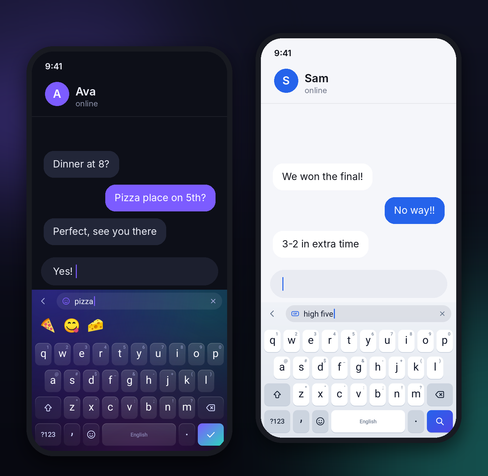
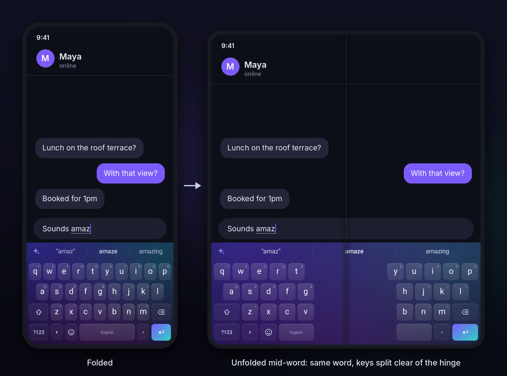

# Lumen

**A keyboard for Android that glows.**


Lumen is a fast, private, beautifully drawn keyboard. Every key, icon and effect
is painted in code: keys squash and spring back under your fingers, a soft bloom
of light spreads from each press, glide typing leaves a glowing comet trail, and
eleven hand-tuned themes (including Material You and a real frosted-glass theme)
make it feel at home on any phone.

## Highlights

- **Light you can feel.** Spring-loaded keys, light blooms, floating key pop-ups,
  a gradient enter key and crisp icons drawn on a single 24-unit grid.
- **Glide typing.** Slide across the letters and Lumen matches the shape and
  position of your path against 60,000 words, with a live preview as you glide.
- **Autocorrect that knows the keyboard.** It weighs which keys are neighbours and
  exactly where you tapped, fixes missing apostrophes (`dont` → `don't`), and one
  tap of backspace undoes it.
- **Predictions.** Word completions, next-word predictions, emoji suggestions
  (🍕 when you type “pizza”), smart punctuation spacing, double-space full stop and
  auto-capitalisation.
- **Search from the keyboard.** Find any emoji by name (“pizza”, “lol”), search
  GIFs and send them straight into the conversation, or look something up on the
  web with the text you've selected already filled in.
- **Learns you, privately.** New words and phrases are learned on the device and
  never leave it, and Lumen never learns from password or incognito fields.
- **Eleven themes.** Aurora, Material You, Glass (real background blur on
  Android 12+), Graphite, Midnight (AMOLED), Frost, Paper, Sakura, Ocean, Forest
  and Sunset. Four key shapes plus a borderless mode, all switchable from the keyboard.
- **Everything at hand.** Emoji with skin tones and recents, clipboard history
  with pins and a one-tap paste chip, space-bar cursor control, swipe left from
  backspace to delete whole words, long-press for accents and symbols, an optional
  number row, and QWERTY, QWERTZ, AZERTY, Colemak and Dvorak layouts.
- **Made for foldables.** Open a foldable (or use a tablet) and the keys split
  between your thumbs, with the opening over the hinge and a space bar on each side.
  Fold or unfold mid-word and you carry on with the same word, suggestions, page
  and panel. Number pads stay compact on wide screens, and the app becomes a
  centred column that keeps its place.
- **Built to be light.** No third-party libraries; the keyboard is a handful of
  custom views drawn on the canvas.

## Screenshots







## Install

1. Download `lumen-<version>.apk` from the
   [latest release](../../releases/latest) and install it.
2. Open **Lumen** and follow the two setup steps: turn Lumen on, then switch to it.

### Updates

The Lumen app keeps itself current. When a new version is out, its **Updates**
card offers it, and **Update** installs it over the old one, keeping your
settings and learned words. Android asks once to let Lumen install apps, and
then confirms each update. Turn off **Check automatically** to check only when
you tap **Check**.

### Releases (for the repository owner)

Every merge to `main` is built, signed with Lumen's own key and published as a
release, which is what the app updates from. The key lives in two repository
secrets (**Settings → Secrets and variables → Actions**), never in the code:

- `LUMEN_SIGNING_KEY`: a PKCS12 keystore holding a key named `lumen`, base64-encoded.
- `LUMEN_SIGNING_PASSWORD`: its password.

```sh
keytool -genkeypair -keystore lumen.p12 -storetype PKCS12 -alias lumen \
  -keyalg RSA -keysize 4096 -validity 36500 -dname "CN=Lumen"
base64 -w0 lumen.p12   # paste the output into LUMEN_SIGNING_KEY
```

Keep a copy of the keystore and its password somewhere safe: with a new key,
the next version has to be installed fresh. Whoever holds the key can ship
updates to your keyboard, so never commit it. Without the secrets, CI signs with
a throwaway debug key and publishes no release; those APKs (the `lumen-apk`
artifact of each **Build** run) only install after uninstalling Lumen.

## GIFs

GIF search uses [GIPHY](https://developers.giphy.com/) or
[KLIPY](https://partner.klipy.com/), and both need a free API key. (Tenor's API,
which many keyboards used, was shut down in June 2026.)

1. Get a key. For GIPHY, sign in to the developer dashboard, choose
   **Create an App** and pick **API**. For KLIPY, sign up to the partner panel and
   add a key under **API Keys**.
2. In the Lumen app, under **GIFs**, choose the service and paste the key.

To build a key into the app instead, add a repository secret named
`GIPHY_API_KEY` or `KLIPY_API_KEY` (CI builds pick it up), or pass
`-PgiphyApiKey=...` or `-PklipyApiKey=...` to Gradle. Anyone with the APK can read
a built-in key, so keep those builds to yourself. Free keys allow about 100
requests an hour; Lumen reuses pages it loaded in the last ten minutes, so
reopening the GIF panel costs nothing.

## Build

You need JDK 17+ and the Android SDK (Android Studio is the easiest way).

```sh
./gradlew assembleRelease        # app/build/outputs/apk/release/app-release.apk
./gradlew testDebugUnitTest      # typing engine tests and the glide benchmark
```

## How it works

| Package | What lives there |
| --- | --- |
| `engine/` | Pure-Kotlin typing engine: a compact trie of 160,000 words, a weighted Damerau–Levenshtein search driven by a tap spatial model, next-word prediction, on-device learning, the glide decoder and emoji search. Unit-tested on the JVM. |
| `keyboard/` | Layouts, the key painter, the icon set, `KeyboardView` (touch handling, rollover, long-press panels, cursor and delete swipes, animations) and the glide trail. |
| `ime/` | `LumenIME` (the input method service), `InputLogic` (composing, autocorrect with undo, smart spacing, cursor tracking), haptics and the engine loader. |
| `update/` | The in-app updater: finds the latest GitHub release, downloads it and hands it to Android's package installer. |
| `ui/` | The suggestion strip, the search bar, the emoji, GIF, clipboard and theme panels, and the root view that handles window insets. |
| `data/` | Emoji data, clipboard history, and GIFs: the GIPHY/KLIPY client, preview loading and the content provider that hands GIFs to apps. |
| `theme/` | Theme definitions, including Material You colours from the wallpaper. |
| `settings/` | The companion app: setup, live theme gallery and preferences. |

The dictionary and emoji assets are generated from upstream data by the scripts
in `tools/`; see [THIRD_PARTY_NOTICES.md](THIRD_PARTY_NOTICES.md).

## Privacy

The keyboard only goes online for GIFs. Opening the GIF panel loads trending
GIFs from the service you chose (GIPHY or KLIPY), and your GIF searches go there
too, with your language and region; like any website, the service also sees your
IP address. Nothing else you type is sent anywhere. The Lumen app asks GitHub
whether a new version is out when you open it, and downloads updates from there.
With GIF search and automatic update checks turned off, Lumen never connects on
its own. Web search hands your search to your browser or search app. Learned
words stay in the app's private storage, are left out of backups and transfers
to a new phone, and can be cleared from the app. Clipboard history is kept in
memory for an hour (pinned clips are saved), and clips that apps mark as
sensitive, such as passwords, are never recorded.
